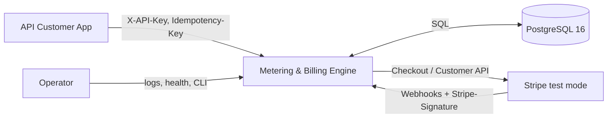
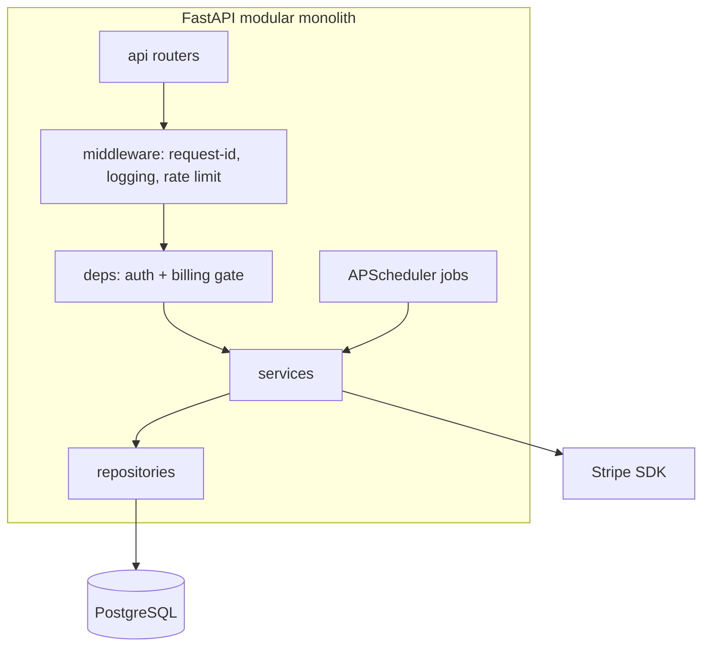
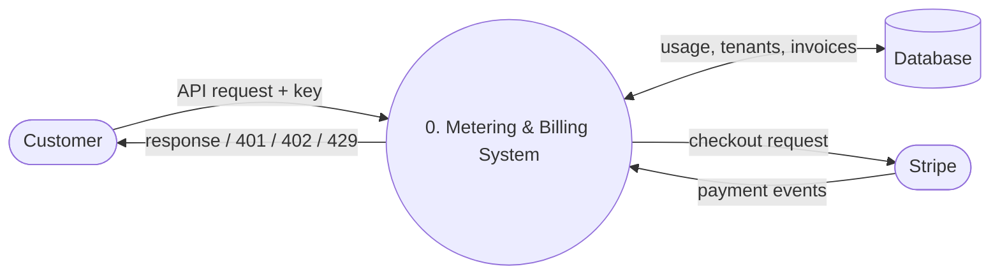
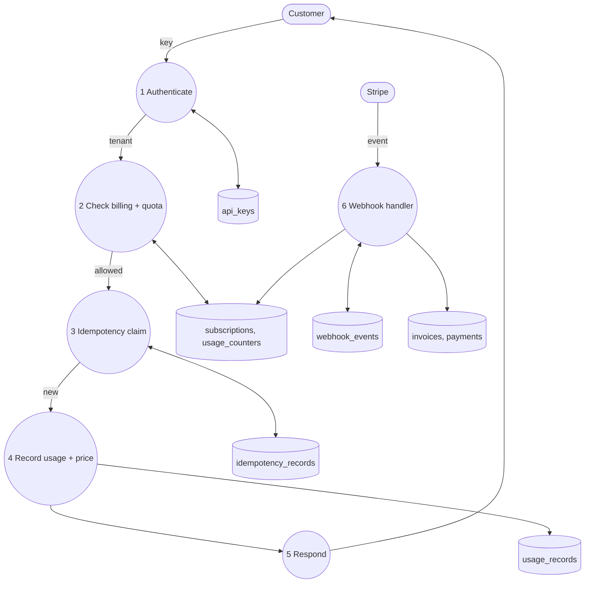
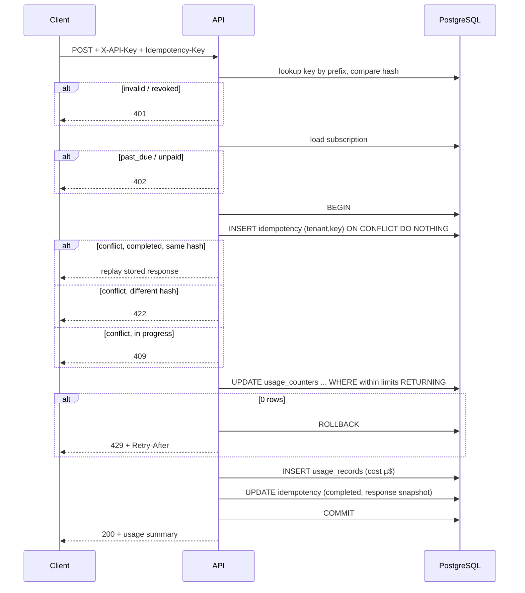
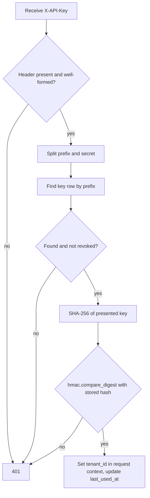
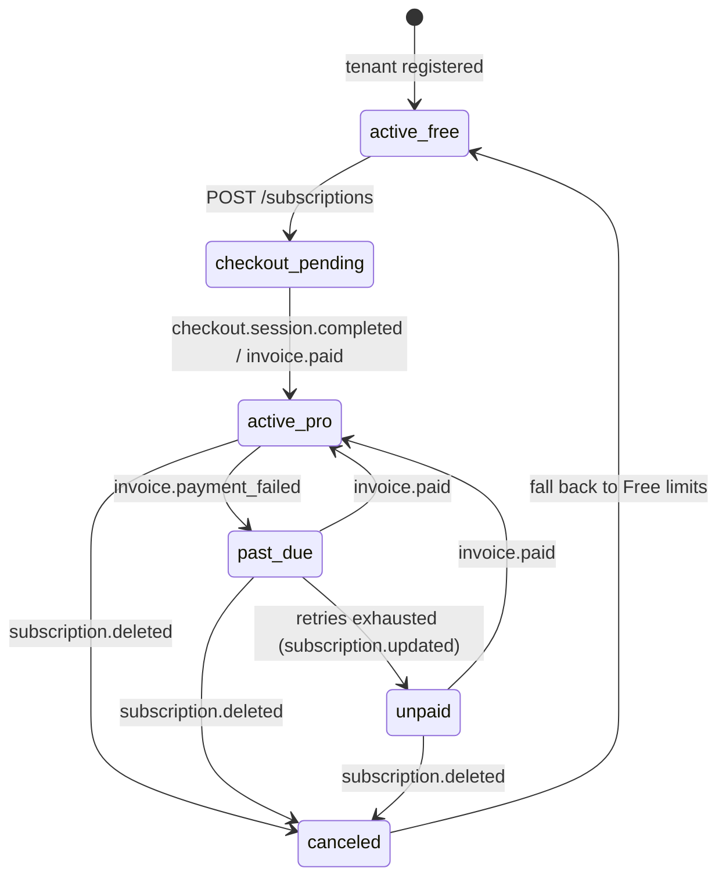
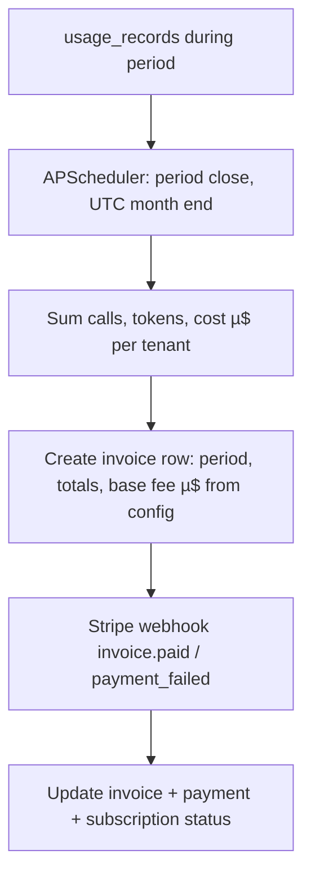
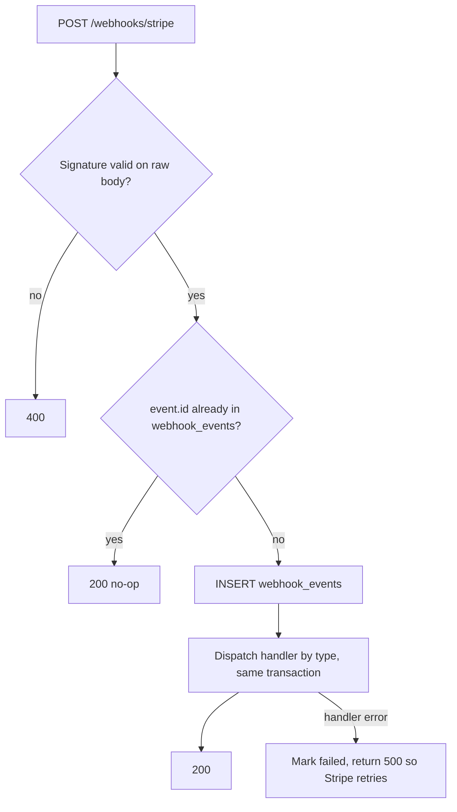

Architecture (Planned, nothing implemented yet)

Style: modular monolith. One deployable FastAPI app, one PostgreSQL database. No extra microservices, because there is no scaling or team-boundary reason for them yet.

1. System context

DIAGRAM SOURCE (Mermaid)

Plain words: customers call our API; we store everything in Postgres; Stripe tells us when payments succeed or fail.

2. Components and responsibilities

Component Responsibility Module
1 FastAPI app Routing, validation, error mapping, OpenAPI docs app/main.py, app/api/
2 Authentication Create/verify/revoke API keys, resolve tenant services/auth.py, api/deps.py
3 Tenant management Register, read, update tenant services/tenants.py
4 Subscription management Plans, subscription status, billing period services/subscriptions.py
5 Usage metering Write usage ledger rows services/metering.py
6 Quota enforcement Atomic check-and-increment services/quota.py
7 Pricing engine Tokens → µ$ (pure functions) services/pricing.py
8 Billing Period close, invoices, payment mirror services/billing.py
9 Idempotency Claim/complete/replay keys services/idempotency.py
10 Webhook handler Verify, dedupe, dispatch Stripe events services/webhooks.py
11 PostgreSQL System of record, constraints db/, migrations/
12 Reporting Read-only usage/billing queries services/reporting.py

Layering: api → services → repositories → db. Routers never touch SQL.

3. High-level architecture

DIAGRAM SOURCE (Mermaid)

4. Level 0 DFD

DIAGRAM SOURCE (Mermaid)

5. Level 1 DFD

DIAGRAM SOURCE (Mermaid)

6. Request lifecycle (POST /v1/usage/simulate)

DIAGRAM SOURCE (Mermaid)

Why one transaction: if anything fails, counter, record, and idempotency row all roll back together, so retries are safe.

7. Authentication flow

DIAGRAM SOURCE (Mermaid)

8. Subscription lifecycle

DIAGRAM SOURCE (Mermaid)

9. Billing workflow

DIAGRAM SOURCE (Mermaid)

10. Webhook flow

DIAGRAM SOURCE (Mermaid)

11. Folder structure

usage-metering-billing-engine/
├── app/
│   ├── main.py            # app factory, router mounting
│   ├── core/              # config (pydantic-settings), security, logging, errors
│   ├── api/               # routers + dependencies (HTTP only)
│   ├── models/            # SQLAlchemy 2.0 models
│   ├── schemas/           # Pydantic request/response models
│   ├── services/          # business rules
│   ├── repositories/      # DB access
│   ├── middleware/        # request-id, rate limit
│   ├── db/                # engine, session, base
│   └── utils/             # time/period helpers, money helpers
├── migrations/            # Alembic
├── tests/                 # unit/, integration/, concurrency/
├── docs/
├── scripts/               # seed plans, dev helpers
├── Dockerfile
├── docker-compose.yml
├── requirements.txt
├── .env.example
└── README.md
