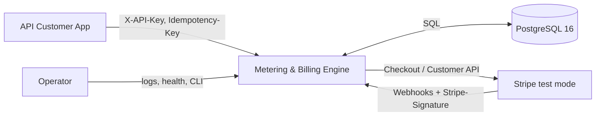
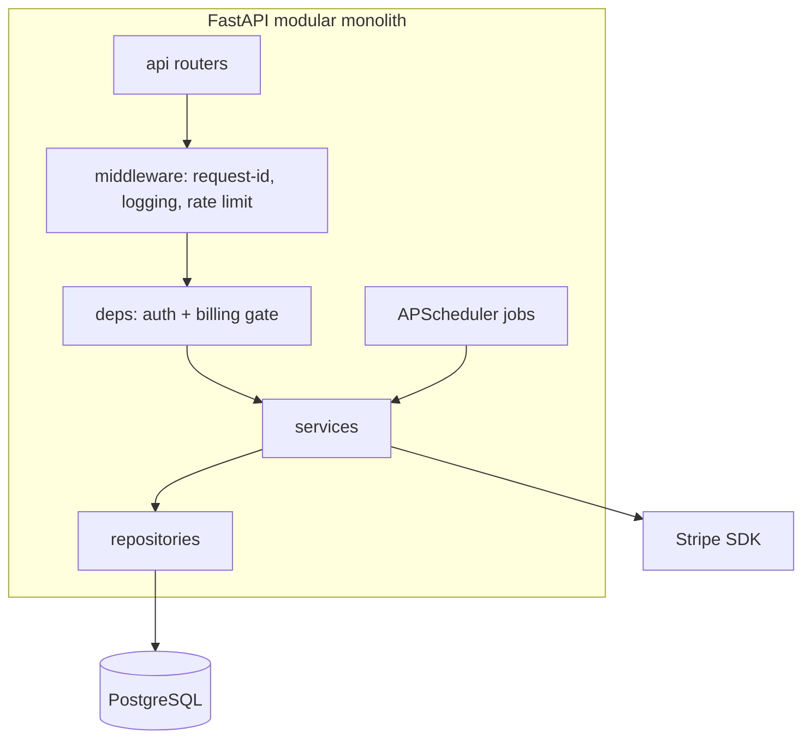
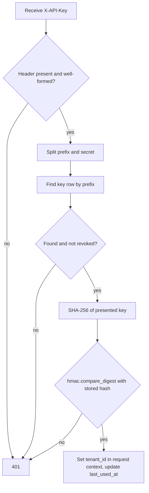
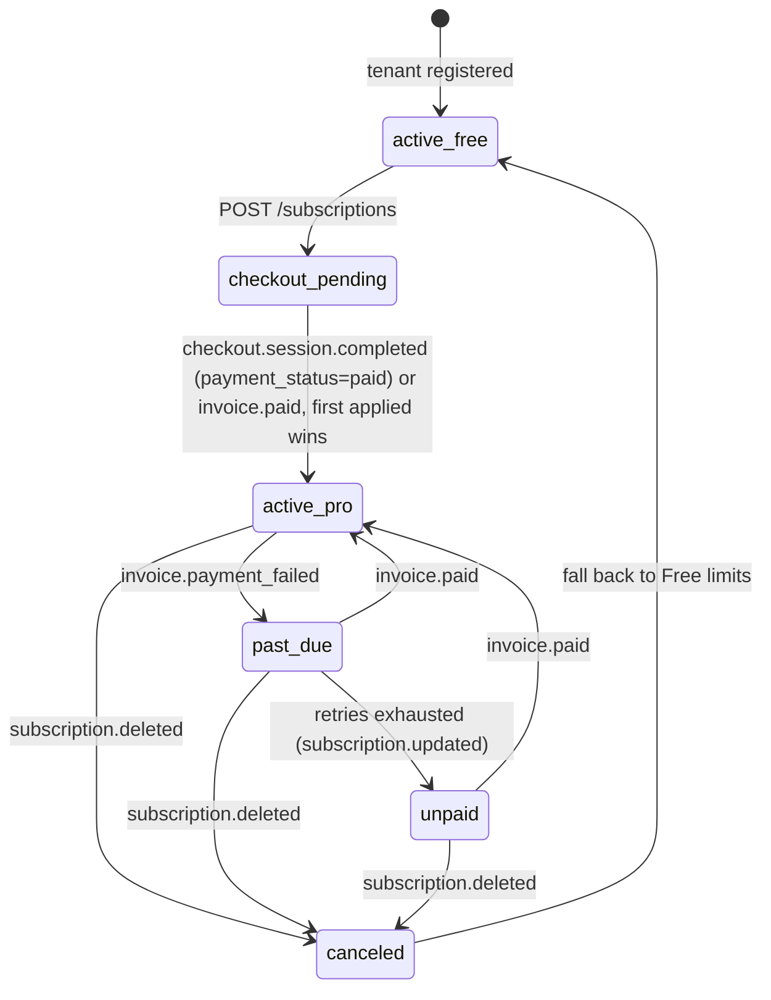
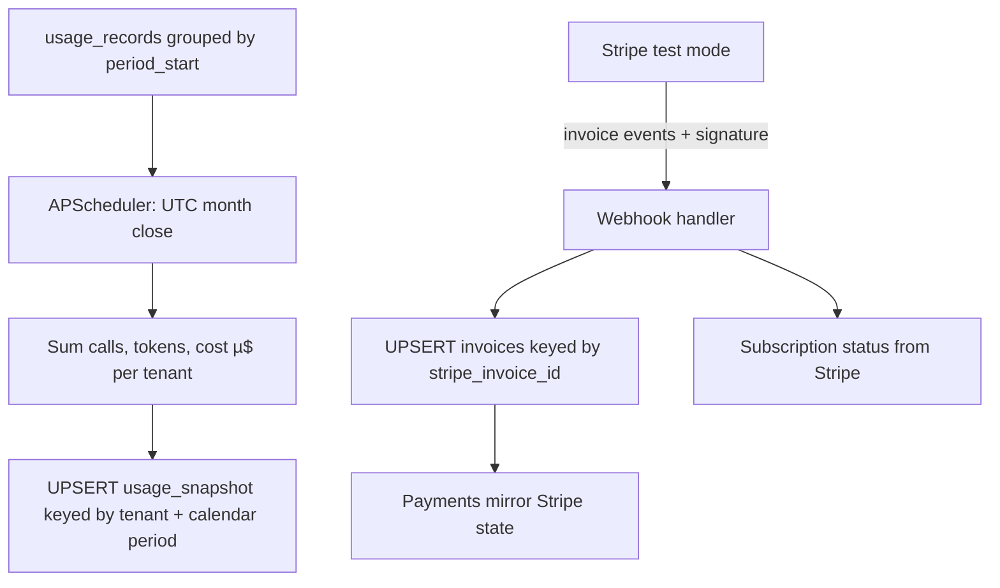
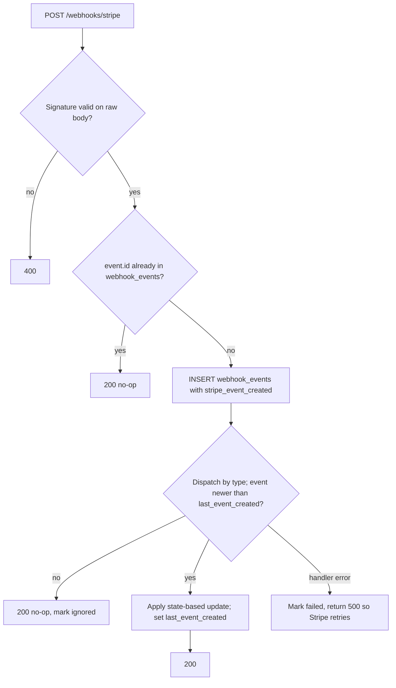

Architecture (Planned, nothing implemented yet)

Style: modular monolith. One deployable FastAPI app, one PostgreSQL database. No extra microservices, because there is no scaling or team-boundary reason for them yet.

1. System context

DIAGRAM SOURCE (Mermaid)



Plain words: customers call our API; we store everything in Postgres; Stripe tells us when payments succeed or fail.

2. Components and responsibilities

Component Responsibility Module
1 FastAPI app Routing, validation, error mapping, OpenAPI docs app/main.py, app/api/
2 Authentication Create/verify/revoke API keys, resolve tenant services/auth.py, api/deps.py
3 Tenant management Register, read, update tenant services/tenants.py
4 Subscription management Plans, subscription status, billing period services/subscriptions.py
5 Usage metering Write usage ledger rows services/metering.py
6 Quota enforcement Atomic check-and-increment services/quota.py
7 Pricing engine Tokens → µ$ (pure functions) services/pricing.py
8 Billing Period close, invoices, payment mirror services/billing.py
9 Idempotency Claim/complete/replay keys services/idempotency.py
10 Webhook handler Verify, dedupe, dispatch Stripe events services/webhooks.py
11 PostgreSQL System of record, constraints db/, migrations/
12 Reporting Read-only usage/billing queries services/reporting.py

Layering: api → services → repositories → db. Routers never touch SQL.

3. High-level architecture

DIAGRAM SOURCE (Mermaid)



4. Level 0 DFD

DIAGRAM SOURCE (Mermaid)


5. Level 1 DFD

DIAGRAM SOURCE (Mermaid)


6. Request lifecycle (POST /v1/usage/simulate)

DIAGRAM SOURCE (Mermaid)

```mermaid
sequenceDiagram
    participant C as Client
    participant A as API
    participant DB as PostgreSQL
    C->>A: POST + X-API-Key + Idempotency-Key
    A->>DB: lookup key by prefix, compare hash
    alt missing / invalid / revoked key
        A-->>C: 401 (no claim)
    end
    alt Idempotency-Key missing or malformed
        A-->>C: 422 validation_error (no claim)
    end
    A->>DB: read-only billing gate: load subscription
    alt past_due / unpaid
        A-->>C: 402 (no claim created)
    end
    Note over A,DB: Transaction 1 - claim, COMMITTED before business work; max 3 attempts if the row disappears
    loop at most 3 attempts when conflict read finds no row
        A->>DB: BEGIN
        A->>DB: INSERT claim (tenant,key,hash,owner,expires=now()+60s) ON CONFLICT DO NOTHING
        alt new row
            A->>DB: COMMIT (in_progress now visible to others)
        else conflict, completed + same hash
            A->>DB: ROLLBACK
            A-->>C: 200 replay + Idempotency-Replayed: true
        else conflict, any state + different hash
            A->>DB: ROLLBACK
            A-->>C: 422 idempotency_key_reuse (never takeover, never 409)
        else conflict, in_progress + same hash + not expired
            A->>DB: ROLLBACK
            A-->>C: 409 idempotency_in_progress
        else conflict, in_progress + same hash + expired
            A->>DB: UPDATE claim SET owner=new, expires=now()+60s WHERE state='in_progress' AND expires_at < now() RETURNING
            alt one row returned
                A->>DB: COMMIT (lease taken over)
            else zero rows
                A->>DB: ROLLBACK
                A-->>C: 409 idempotency_in_progress
            end
        else conflict but row deleted before read
            A->>DB: ROLLBACK (retry, attempt++)
        end
    end
    Note over A,DB: Transaction 2 - usage, all-or-nothing
    A->>DB: BEGIN
    A->>DB: re-check subscription status inside the transaction
    alt now past_due / unpaid
        A->>DB: ROLLBACK
        A->>DB: DELETE claim WHERE owner=:owner (commit)
        A-->>C: 402 billing_past_due / billing_unpaid
    end
    A->>DB: compute period_start = current UTC month start, once per request
    A->>DB: INSERT usage_counters (tenant, period_start, zeros) ON CONFLICT DO NOTHING
    A->>DB: UPDATE usage_counters ... WHERE within limits RETURNING
    alt 0 rows
        A->>DB: SELECT calls/tokens FROM usage_counters (same transaction)
        A->>DB: ROLLBACK
        A->>DB: DELETE claim WHERE owner=:owner (commit)
        A-->>C: 429 quota_calls_exceeded if calls exhausted else quota_tokens_exceeded + Retry-After
    end
    A->>DB: INSERT usage_records (cost µ$, period_start, idem key)
    alt IntegrityError on unique (tenant_id, idempotency_key)
        A->>DB: ROLLBACK
        A-->>C: 409 idempotency_in_progress
    end
    A->>DB: UPDATE idempotency SET state='completed', completed_at=now(), expires=completed_at+retention, status/body WHERE owner=:owner RETURNING
    alt 0 rows (stale owner lost the lease)
        A->>DB: ROLLBACK (no ledger row, no counter change)
        A-->>C: 409 idempotency_in_progress
    else 1 row
        A->>DB: COMMIT
        A-->>C: 200 + usage summary
    end
```

Transaction 1 makes the claim visible to other connections; that is the only reason a concurrent same-key request can receive 409. Transaction 2 keeps counter + ledger + completion atomic, so a failure or crash can never leave a half-written usage record. A different request hash on an in-progress or expired claim returns 422 and never takes over. On 402/429 the claim is released before the error is returned; on a replay no write happens. A-9: the counter row is created lazily after the in-transaction billing re-check; the APScheduler close job only reads usage_records and writes invoices idempotently, never usage_counters. A-12: a zero-row update reads the counter in the same transaction to choose the 429 code, with calls taking precedence.

7. Authentication flow

DIAGRAM SOURCE (Mermaid)



8. Subscription lifecycle

DIAGRAM SOURCE (Mermaid)



9. Billing workflow

DIAGRAM SOURCE (Mermaid)



The close job writes only usage_snapshots; invoices and payments are created only by Stripe webhooks (A-14). Free tenants get no invoices.

10. Webhook flow

DIAGRAM SOURCE (Mermaid)



On equal `event.created`, apply the event whose state is further along (`checkout_pending` < `active` < `past_due` < `unpaid` < `canceled`) or re-fetch from Stripe (A-15, TC-A15-01).

11. Folder structure

usage-metering-billing-engine/
├── app/
│   ├── main.py            # app factory, router mounting
│   ├── core/              # config (pydantic-settings), security, logging, errors
│   ├── api/               # routers + dependencies (HTTP only)
│   ├── models/            # SQLAlchemy 2.0 models
│   ├── schemas/           # Pydantic request/response models
│   ├── services/          # business rules
│   ├── repositories/      # DB access
│   ├── middleware/        # request-id, rate limit
│   ├── db/                # engine, session, base
│   └── utils/             # time/period helpers, money helpers
├── migrations/            # Alembic
├── tests/                 # unit/, integration/, concurrency/
├── docs/
├── scripts/               # seed plans, dev helpers
├── Dockerfile
├── docker-compose.yml
├── requirements.txt
├── .env.example
└── README.md
