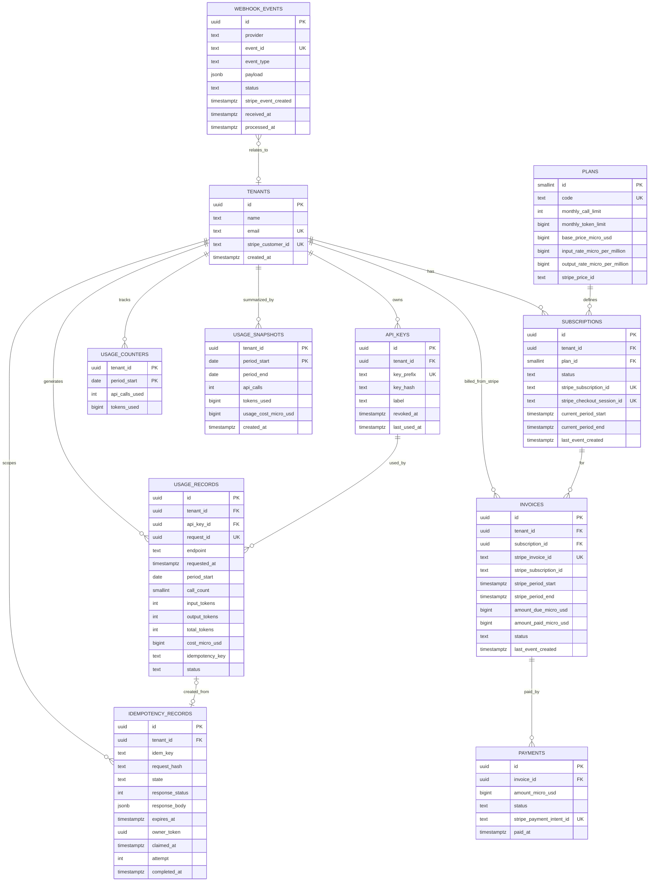

Database Design (Planned)

PostgreSQL 16, SQLAlchemy 2.0, Alembic. All timestamps TIMESTAMPTZ stored in UTC. All money BIGINT micro-dollars (µ$). Primary keys are UUIDs (v4) unless noted.

ER diagram

DIAGRAM SOURCE (Mermaid)



Tables

tenants

Purpose: the customer account (also the isolation boundary). Constraints: email unique; stripe_customer_id unique, nullable. Index: unique on email. Why no users table: v1 has no human logins; tenant + API keys is enough. `stripe_customer_id` is created in `POST /subscriptions` before Checkout; webhook handlers match events by customer id first, then by subscription id (A-16).

api_keys

Purpose: credentials. Key format (proposed): ume_<prefix8>_<secret43> where the secret is 32 random bytes, URL-safe base64. Columns: key_prefix (unique, lookup), key_hash (SHA-256 hex of the full key), revoked_at (soft revoke), last_used_at. FK: tenant_id → tenants.id ON DELETE CASCADE. Index: unique key_prefix; index tenant_id. Rule: plaintext never persisted.

plans

Purpose: Free and Pro definitions. Limits live here, not in code. Seeded by scripts/seed_plans.py. CHECK: limits ≥ 0, prices ≥ 0. Free base_price_micro_usd = 0. Pro price is read from config at seed time (no invented default). D-1: these limits hard-stop both plans with 429; no overage in v1.

subscriptions

Purpose: a tenant's plan + billing status. CHECKs: status IN ('checkout_pending','active','past_due','unpaid','canceled'). Constraint: partial unique index on (tenant_id) WHERE status <> 'canceled' so a tenant has one live subscription. FKs: tenant_id, plan_id. `last_event_created` stores the newest applied Stripe event timestamp; handlers ignore older or equal events (A-15). `customer.subscription.deleted` sets `status='canceled'` at event time (end of paid period if `cancel_at_period_end`); Free limits then apply with no counter reset (D-6, A-11). `stripe_checkout_session_id` is nullable and unique when present; Checkout sessions set `client_reference_id` and `metadata.tenant_id`. A pending session is retrieved from Stripe and reused only while `status='open'`; if a replacement session is created, the old open session is expired (A-16). `checkout.session.expired` reverts `checkout_pending` to `active` Free and clears the field.

usage_counters

Purpose: fast, atomic monthly totals (the thing quota updates hit). PK: (tenant_id, period_start). CHECK: api_calls_used >= 0, tokens_used >= 0. Row is created with INSERT ... ON CONFLICT DO NOTHING on first use in a period. Atomic update:

```
UPDATE usage_counters
SET api_calls_used = api_calls_used + 1,
    tokens_used    = tokens_used + :tokens
WHERE tenant_id = :t AND period_start = :p
  AND api_calls_used + 1 <= :call_limit
  AND tokens_used + :tokens <= :token_limit
RETURNING api_calls_used, tokens_used;   -- 0 rows => quota exceeded => 429
```

Postgres row-level locking serializes concurrent updates on the same row, which is why this cannot be bypassed.

usage_records (append-only ledger)

Purpose: audit trail and billing source. Constraints: request_id unique; total_tokens = input_tokens + output_tokens (CHECK); tokens and cost ≥ 0; status IN ('succeeded','failed'). Unique: (tenant_id, idempotency_key) where key not null. `period_start` (DATE) is set from the same once-per-request UTC value used for `usage_counters`; the close job groups by `period_start`, not `requested_at` (FR-20). Indexes: (tenant_id, requested_at DESC) for history; (tenant_id, period_start) for period sums. Scale note: can be range-partitioned by month later (future scope).

idempotency_records

Purpose: dedupe retries. Unique: (tenant_id, idem_key). request_hash = SHA-256 of canonical body+method+path. state IN ('in_progress','completed'). `expires_at` has two meanings: while `in_progress` it is the 60-second lease (`IDEMPOTENCY_CLAIM_TTL_SECONDS`); once `completed` it is the retention deadline, set to `completed_at + IDEMPOTENCY_RETENTION_HOURS` (default 24) in the same transaction as the usage record. New columns: owner_token (UUID4, rotates on takeover), claimed_at, attempt (INTEGER NOT NULL DEFAULT 0), completed_at. Index: (state, expires_at). The claim INSERT commits before the usage transaction so other connections can see in_progress (FR-16). A different request hash on any state returns 422 and never takes over. A 402/429 releases the claim by DELETE with owner_token; a crash leaves the lease to expire. The cleanup job deletes **only expired completed rows** (state='completed' AND expires_at < now()); it never deletes an in-progress claim. Retries after the retention window are new requests. The ledger's unique (tenant_id, idempotency_key) plus owner-token conditional completion prevent duplicate usage rows.

invoices / payments

Purpose: Stripe mirror only. Invoices and payments are created/updated exclusively by Stripe webhook handlers; Stripe is authoritative for status and amounts. Key: stripe_invoice_id NOT NULL UNIQUE; there is deliberately no unique (tenant_id, period_start), because Stripe's billing period differs from the UTC calendar month (A-10, A-14). CHECK: amount_due_micro_usd >= 0, amount_paid_micro_usd >= 0, status IN ('draft','open','paid','uncollectible','void'). `last_event_created` stores the newest applied Stripe event timestamp; handlers ignore older or equal events (A-15). Stripe cent amounts are converted to µ$ with integer arithmetic (cents * 10_000), never float. Free tenants have no Stripe invoices or payments, hence no rows. D-2: Pro is a flat monthly fee; usage cost is recorded on usage_records and usage_snapshots for reporting only and is never added to a Stripe invoice total.

usage_snapshots

Purpose: idempotent UTC calendar-month summary written by the APScheduler close job. PK (tenant_id, period_start); CHECK api_calls >= 0, tokens_used >= 0, usage_cost_micro_usd >= 0. Written with INSERT ... ON CONFLICT (tenant_id, period_start) DO UPDATE, so reruns are safe. This is NOT an invoice and is never sent to Stripe. Free tenants can have snapshots (usage reporting) but no invoices.

webhook_events

Purpose: dedupe + audit of provider events. Unique: (provider, event_id). status IN ('received','processed','failed','ignored'). `stripe_event_created` stores Stripe's `created` timestamp in UTC; handlers compare it with `last_event_created` on invoices/subscriptions and ignore older events. On equal timestamps they apply the event whose state is further along (`checkout_pending` < `active` < `past_due` < `unpaid` < `canceled`) or re-fetch from Stripe (A-15, TC-A15-01).

Multi-tenant isolation

Shared database, shared schema, tenant_id on every tenant-owned table. Every repository method requires tenant_id as a parameter. Tests prove tenant A gets 404 for tenant B's IDs. (Optional hardening later: Postgres row-level security.)

Money

1 USD = 1,000,000 µ$. Display: usd = micro // 1_000_000, remainder shown as 6-decimal string built from integers (never float). Cost formula:

```
cost_µ$ = (input_tokens * input_rate + output_tokens * output_rate + 500_000) // 1_000_000
```

where rates are µ$ per 1M tokens. The +500_000 implements half-up rounding. Rates are configuration; no real-world prices are assumed.

Sample records (illustrative placeholders)

table row
plans free, 1000, 100000, 0 · pro, 50000, 5000000, $PRO_PRICE_MICRO_USD
tenants Acme Labs, dev@acme.example
subscriptions Acme → free, active, 2026-11-01 → 2026-12-01
usage_records request 0b1…, /v1/usage/simulate, 1 call, 120 in, 380 out, 500 total, cost per configured rates, succeeded

Initialization (will be finalized in Phase 3)

docker compose up -d db
alembic upgrade head
python scripts/seed_plans.py
